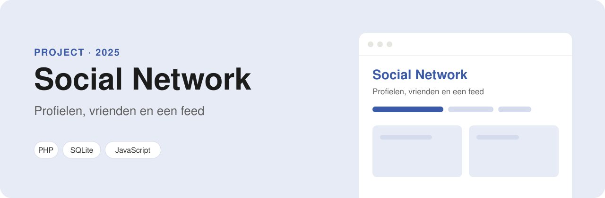

<p align="center">
  
</p>

<p align="center">
  
  
  
  
</p>

# Social Network (Pynch)

Een klein sociaal netwerk, gebouwd in gewone PHP zonder framework. Je maakt een account, vult je profiel in, voegt vrienden toe en plaatst berichten. Dit was het project waarin ik voor het eerst zelf een inlogsysteem bouwde.

## Functies

- **Registreren en inloggen**, met controle van de formulieren in JavaScript.
- **Profiel**: naam, bijnaam, woonplaats, een stukje over jezelf en een profielfoto.
- **Berichten plaatsen**, met of zonder foto. Een bericht is openbaar of alleen voor vrienden.
- **Feed** (`home.php`): je eigen berichten, openbare berichten en berichten van je vrienden.
- **Vrienden**: vriendverzoeken sturen, accepteren (`requests.php`) en je vriendenlijst bekijken (`friends.php`).
- **Zoeken** (`search.php`) op naam, e-mailadres, woonplaats of in berichten.

## Zelf draaien

Je hebt alleen PHP nodig (bijvoorbeeld XAMPP); een database hoef je niet in te stellen. De site gebruikt **SQLite**: bij het eerste bezoek maakt hij zelf `private/database.sqlite` aan, met de voorbeelddata uit `private/database.sql`.

1. Clone het project in de map van je webserver (bij XAMPP is dat `htdocs`):
   ```bash
   git clone https://github.com/ParisAngelopoulos/socialnetwork.git
   ```
2. Ga naar http://localhost/socialnetwork en log in met een van de testaccounts, of maak zelf een account aan.

Wil je opnieuw beginnen met alleen de voorbeelddata? Verwijder dan `private/database.sqlite`.

### Testaccounts

In de database staan vijf gebruikers met berichten, vriendschappen en openstaande vriendverzoeken. Ze hebben allemaal het wachtwoord `welkom123`.

| Naam | E-mailadres |
| --- | --- |
| Paris Angelopoulos | `paris@voorbeeld.nl` (heeft 2 vriendverzoeken openstaan) |
| Sanne de Vries | `sanne@voorbeeld.nl` |
| Daan Bakker | `daan@voorbeeld.nl` |
| Youssef El Amrani | `youssef@voorbeeld.nl` |
| Lisa Jansen | `lisa@voorbeeld.nl` |

De verbinding met de database staat in `functions/functions.php` (standaard `root` zonder wachtwoord op `localhost`).

## Mappen

| Map / bestand | Wat erin staat |
| --- | --- |
| `index.php` | Inloggen en registreren |
| `home.php` | De feed en een nieuw bericht plaatsen |
| `profile.php` | Profielpagina's en vriendverzoeken |
| `includes/` | Stukken die op meer pagina's terugkomen (navigatie, bericht, profiel) |
| `functions/` | Databaseverbinding (SQLite) en uploaden van foto's |
| `private/` | De database en `database.sql` met de tabellen en voorbeelddata (niet via het web te openen) |
| `data/images/` | Geüploade profiel- en berichtfoto's |
| `resources/` | CSS en JavaScript |

## Wat ik geleerd heb

- Hoe sessies werken en hoe je pagina's afschermt voor wie niet is ingelogd.
- Hoe je met SQL-joins een feed samenstelt uit je eigen berichten en die van je vrienden.
- Foto's uploaden en aan een gebruiker of bericht koppelen.

## Beveiliging

- Alle invoer van gebruikers gaat via **prepared statements** (`db_query()` in `functions/functions.php`), dus niemand kan SQL in een zoekveld of formulier typen.
- Alles wat gebruikers schrijven wordt **ge-escaped** (`h()`) voordat het op de pagina komt, zodat een bericht geen JavaScript kan uitvoeren.
- Wachtwoorden worden opgeslagen met `password_hash`. Oude md5-wachtwoorden worden bij de eerste keer inloggen vanzelf omgezet.
- Bij uploads worden alleen JPG, PNG en GIF geaccepteerd, en het bestand moet echt een afbeelding zijn.

---

Gemaakt door **Paris Angelopoulos**, web developer in opleiding · [GitHub](https://github.com/ParisAngelopoulos) · [parisangelopoulos@gmail.com](mailto:parisangelopoulos@gmail.com)
